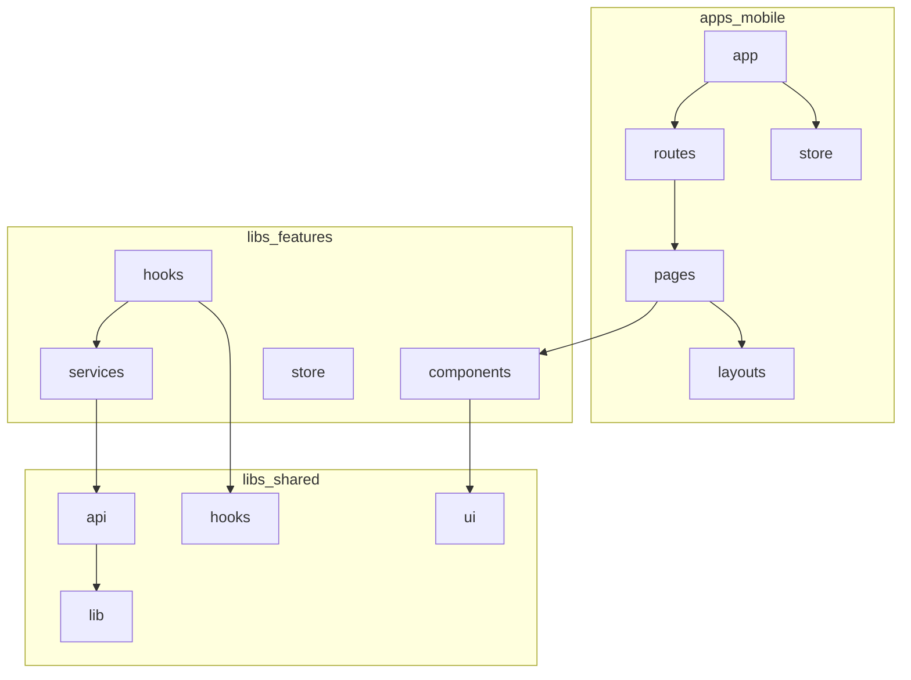
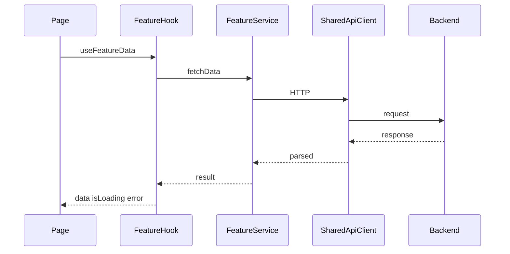

# Arquitetura frontend — Startup

Guia interno alinhado a [React Architecture: A Complete Guide for Scalable Front-End Applications](https://medium.com/@rohitkuwar/react-architecture-a-complete-guide-for-scalable-front-end-applications-05e2ab8a79d7): **feature-based**, **UI → Hooks → Service → API**, rotas/layouts desacoplados e estado local vs servidor vs global.

## Camadas no monorepo Nx

| Camada | Local | Responsabilidade |
|--------|--------|------------------|
| Bootstrap | `apps/mobile/src/main.tsx` | Registro do app nativo |
| App shell | `apps/mobile/src/app/` | Providers, composição do navigator |
| Routes | `apps/mobile/src/routes/` | Rotas, tipos, guards |
| Layouts | `apps/mobile/src/layouts/` | Stacks/tabs (React Navigation) |
| Pages | `apps/mobile/src/pages/` | Telas finas; compõem features |
| Features | `libs/features/<nome>/` | Negócio: UI, hooks, services, store |
| Shared UI | `libs/shared/src/ui/` | Componentes genéricos sem regra de negócio |
| Shared API | `libs/shared/src/api/` | Cliente HTTP |
| Shared hooks/lib/config | `libs/shared/src/hooks`, `lib`, `config` | Cross-cutting reutilizável |
| Store global | `apps/mobile/src/store/` | Re-export de stores globais |

## Regras de dependência



- **Proibido:** `libs/shared` importar de `features` ou `apps/mobile`.
- **Proibido:** `features` importarem de outras `features` (preferir shared ou composição na page).
- **Pages** não chamam API diretamente; usam hooks da feature.

## Fluxo de dados



## Onde colocar código novo

| Você está… | Coloque em… |
|------------|-------------|
| Nova tela de rota | `pages/<Nome>Page/` |
| Fluxo de login/cadastro | `libs/features/auth/` (ou nova feature) |
| Botão/input reutilizável | `libs/shared/src/ui/` |
| Chamada HTTP | `libs/features/<x>/services/` + client em `shared/api` |
| Cache/refetch de API | Hook com TanStack Query na feature |
| Toggle de UI local | `useState` no componente |
| Sessão / estado de cliente compartilhado | Slice Redux Toolkit na feature. Plano: [redux.md](redux.md) |

## Estado

| Tipo | Ferramenta |
|------|------------|
| UI efêmera | `useState` |
| Dados de servidor | TanStack Query (via hooks → services) |
| Global de cliente (sessão, filtros compartilhados) | Redux Toolkit. Adoção em fases: [redux.md](redux.md) |

O `authStore` em Zustand permanece até a fase 2 do plano. Feature nova não cria outra store Zustand.

## Componentes

- **Apresentação (`*View.tsx`):** só props e UI.
- **Page / hook:** dados, navegação, efeitos.

## Exemplo: feature `auth`

```
libs/features/auth/src/
  components/AuthStatusView.tsx
  hooks/useAuthStatus.ts
  services/authService.ts
  store/authSlice.ts
  index.ts
```

O arquivo no disco ainda é `store/authStore.ts` (Zustand) até a fase 2 de [redux.md](redux.md).

```typescript
// services/authService.ts — sem React
import { apiClient } from '@startup/shared';
export async function getSession() {
  return apiClient.get<{ userId: string | null }>('/auth/session');
}

// hooks/useAuthStatus.ts
import { useQuery } from '@tanstack/react-query';
import { getSession } from '../services/authService';
export function useAuthStatus() {
  return useQuery({ queryKey: ['auth', 'session'], queryFn: getSession });
}
```

## Navegação (React Native)

Equivalente ao React Router do artigo: config em `routes/`, shells em `layouts/`, telas em `pages/`. Guards em `routes/guards/`.

## Checklist de PR

- [ ] Nenhum `fetch`/axios em componente de UI
- [ ] Imports respeitam camadas (shared ← feature ← app)
- [ ] API pública da feature exportada via `index.ts`
- [ ] Testes atualizados para pages/app
- [ ] Path alias `@startup/*` usado em vez de imports relativos longos entre projetos

## Backend

API em `api`, pacote `com.startup`. A estrutura acompanha o guia [auth-api](https://github.com/Fernanda-Kipper/auth-api): controller, domínio, repositório, serviço, JWT stateless, Postgres e Flyway.

O recurso de exemplo `product` desse guia é o domínio da startup: bebidas (`/drinks`), receitas (`/recipes`), eventos próximos (`/events`) e bebidas salvas (`/saved-drinks`). Contrato e como subir: [api/README.md](../api/README.md).

## Skills Cursor

- `.cursor/skills/react-architecture/` — mapa de camadas e decisões
- `.cursor/skills/feature-scaffold/` — criar nova feature Nx
- `.cursor/skills/api-data-layer/` — services + Query
- `.cursor/skills/redux-state/` — slices, selectors e o que não entra no store
